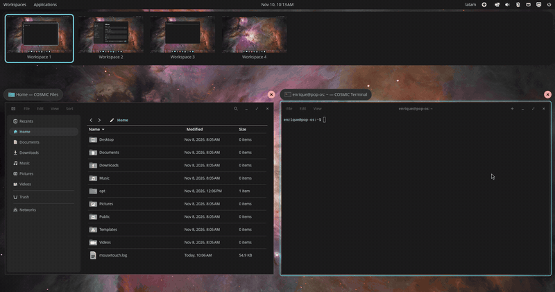

# COSMIC Overview Swipe

Touchpad swipes that follow your fingers **inside the COSMIC workspace
overview** (`Super+W`) on Pop!_OS 24.04, like Mission Control on macOS.

**Website: <https://cosmic-swipe.3m4.net>**



Out of the box, a 3- or 4-finger touchpad swipe switches workspaces in COSMIC,
but does nothing while the workspace overview is open. With this patch the
overview slides between workspaces under your fingers:

- **Follows your fingers 1:1.** It pauses when you pause and goes back when
  you go back. Pointer acceleration is undone, so the distance per workspace
  does not depend on how fast you swipe.
- **Lands where you aim.** A flick moves on, a slow drag settles on the
  nearest workspace, and a long fast swipe can skip several.
- **Both layouts.** It works with horizontal and vertical workspaces, in the
  same direction as COSMIC's own swipe (natural scrolling setting included).
- **Wraps like COSMIC.** Past the last workspace comes the first one when
  COSMIC wraps around; otherwise it stops with a small bounce.
- **Magic Mouse.** Two-finger swipes on an Apple Magic Mouse work too,
  through [MouseTouch](https://mouse.3m4.net) 0.1.13 or newer.
- **Safe to try.** No sudo and nothing in `/usr` changes. After a system
  update with no matching build, COSMIC starts its own overview again.

Outside the overview nothing changes.

## Install

Supported: **Pop!_OS 24.04 with COSMIC**, x86_64 or aarch64. The patched
overview must match your exact `cosmic-workspaces` revision:

```sh
dpkg-query -W cosmic-workspaces
```

| Version shown | Revision | Status |
|---|---|---|
| `1.0.12~1790783807~24.04~cb953ea` | `cb953ea` | supported (latest COSMIC at the time of writing) |
| `0.1.0~1765315332~24.04~954a45c` | `954a45c` | supported (earlier COSMIC release) |

The revision is the part after the last `~`. Then:

```sh
curl -fsSL https://raw.githubusercontent.com/Devace-93/cosmic-overview-swipe/main/get.sh | sh
```

The installer:

1. Downloads the build for your revision from the latest
   [release](https://github.com/Devace-93/cosmic-overview-swipe/releases)
   and verifies its SHA-256 checksum. If your revision has no build, it stops
   without changing anything.
2. Puts it in `~/.local/opt/overview-swipe/` and writes a small wrapper at
   `~/.local/bin/cosmic-workspaces`. COSMIC starts programs by name through
   your `PATH`, where `~/.local/bin` comes before `/usr/bin`, so it runs the
   wrapper instead of the stock overview.
3. Restarts the overview. If it says your session does not look in
   `~/.local/bin` yet, log out and back in once.

Then press `Super+W` and swipe with 3 or 4 fingers.

At every start, the wrapper checks the installed `cosmic-workspaces`
revision. If there is no build for it, as after a system update, it starts
the stock `/usr/bin/cosmic-workspaces`, so an update never runs a mismatched
build.

### Update, status, remove

```sh
# after Pop!_OS updates COSMIC: fetch the build for the new revision (when there is one)
curl -fsSL https://raw.githubusercontent.com/Devace-93/cosmic-overview-swipe/main/get.sh | sh
# what is installed and running
curl -fsSL https://raw.githubusercontent.com/Devace-93/cosmic-overview-swipe/main/get.sh | sh -s status
# back to the stock overview (settings file kept)
curl -fsSL https://raw.githubusercontent.com/Devace-93/cosmic-overview-swipe/main/get.sh | sh -s uninstall
```

## Settings

Optional, in `~/.config/cosmic-overview-swipe.env` (created by the installer
with everything commented out). Apply changes with
`curl -fsSL …/get.sh | sh -s restart`, or by logging out and in.

| Variable | Default | Meaning |
|---|---|---|
| `COSMIC_WORKSPACES_SWIPE_MM` | `20` | Finger travel (mm) per workspace; higher is slower. 30–40 feels calmer on some touchpads. |
| `COSMIC_WORKSPACES_SWIPE_WRAP` | on | Earlier COSMIC (`954a45c`) only: `0` stops at the first/last workspace instead of wrapping. Newer COSMIC follows its own `workspace_wraparound` setting. |

The swipe direction follows the touchpad *natural scrolling* setting in COSMIC
Settings, like COSMIC's own swipe.

## Troubleshooting

| Symptom | Check |
|---|---|
| "No build for cosmic-workspaces …" | Your revision is newer or older than the releases. Nothing was changed. Watch the releases or open an [issue](https://github.com/Devace-93/cosmic-overview-swipe/issues) with the output of `dpkg-query -W cosmic-workspaces`. |
| Swiping in the overview does nothing | Run `status`. "Build for this revision: no" means COSMIC was updated: run the installer again. If the stock overview is running, log out and back in once. |
| Too fast or too slow | Set `COSMIC_WORKSPACES_SWIPE_MM`, then `restart`. |
| Goes the wrong way | Toggle touchpad natural scrolling in COSMIC Settings. |
| Magic Mouse swipes do nothing | Install MouseTouch 0.1.13 or newer, which follows COSMIC's horizontal or vertical layout. |

Logs: `journalctl --user -b | grep -i cosmic_workspaces`.

## How it works

While the overview is open, `cosmic-comp` stops switching workspaces itself
and forwards touchpad swipes to the client under the pointer through
`zwp_pointer_gestures_v1`. The overview (`cosmic-workspaces`, a separate
layer-shell client) never bound that protocol, so the swipe was lost. The
patches:

1. Bind the pointer-gestures protocol and receive swipe begin/update/end.
2. Turn the deltas into a position between workspaces. The protocol's
   deltas are pointer-accelerated, so the patch inverts libinput's touchpad
   acceleration curve to get real finger travel.
3. Capture the windows of the neighbouring workspaces ahead of time and draw
   the visible workspaces side by side while swiping.
4. Settle with a critically damped spring that keeps the release velocity,
   then activate the target workspace.

The series for the latest COSMIC also fixes an overview crash with windows on
several workspaces, a screencopy race upstream: the next frame was requested
before the previous one was destroyed.

## Repository layout

- `patches/cosmic-workspaces/<revision>/`: the patch series for each
  supported upstream revision of
  [cosmic-workspaces-epoch](https://github.com/pop-os/cosmic-workspaces-epoch)
  (also as branches on the fork
  [Devace-93/cosmic-workspaces-epoch](https://github.com/Devace-93/cosmic-workspaces-epoch)).
- `get.sh`: the installer above.
- `scripts/overview-swipe.sh`: build from source instead (`deps`, `build`,
  `try` / `untry`, `install` / `rollback`).
- `.github/workflows/release.yml`: builds every series on Ubuntu 24.04 for
  x86_64 and aarch64; tags publish a release. Pull requests touching the
  patches build them as a check.
- `site/`: the website. Translations are in `site/i18n/<lang>.json`;
  `tools/site-i18n.py extract` refreshes `en.json` from `index.html`, and
  `build` checks them and writes `site/i18n.js`.
- `NOTES.md`: investigation and test notes.
- `patches/cosmic-comp/`: an obsolete patch for older `cosmic-comp` (stop
  wrapping around on swipe); newer COSMIC has a setting for it.

### Build from source

```sh
git clone https://github.com/Devace-93/cosmic-overview-swipe
cd cosmic-overview-swipe
scripts/overview-swipe.sh deps    # build dependencies (sudo apt)
scripts/overview-swipe.sh build   # upstream at your revision + patches (~10 min)
scripts/overview-swipe.sh try     # same wrapper as the installer; undo: untry
```

Adding a new COSMIC revision means porting the series to it (`git am` on
upstream at that revision, fix conflicts), saving it as
`patches/cosmic-workspaces/<revision>/`, and adding the revision to the
`rev` matrix in `release.yml`.

## Status

It is not part of COSMIC and is not submitted to System76 for now. The
patches were written with an AI coding assistant, and the pop-os contribution
rules ask for PRs without AI-generated content. Until that changes, it is
distributed here.

## License

- Patches and the binaries built from them: **GPL-3.0**, the license of
  cosmic-workspaces-epoch. Every release tarball carries the license text and
  a `SOURCE` file with the exact upstream revision and patches.
- Everything else (installer, scripts, site, notes): **MIT**, see `LICENSE`.

COSMIC Overview Swipe is an independent project, not affiliated with or
endorsed by System76. COSMIC and Pop!_OS are trademarks of System76.
